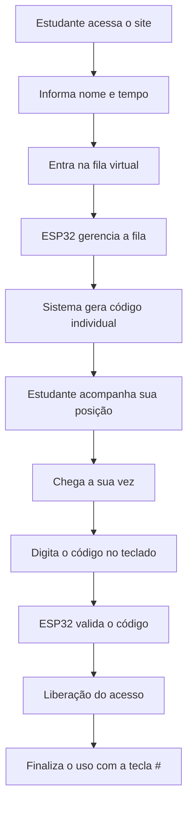

# 🍲 Esquentando com Brisa (Gerenciador de filas para microondas)

### Esquentando sua comida da melhor forma!

Sistema inteligente de gerenciamento de filas para utilização dos micro-ondas do Centro de Informática (CI) da Universidade Federal da Paraíba (UFPB).

---

## 📌 Sobre o projeto

O **Esquentando com Brisa** é um projeto desenvolvido na disciplina de **Introdução à Engenharia da Computação**, com o objetivo de solucionar um problema cotidiano no ambiente universitário: a formação de filas desorganizadas para utilização dos micro-ondas durante os intervalos das refeições.

A proposta consiste no desenvolvimento de um sistema integrado de hardware e software que permite aos estudantes entrarem em uma fila virtual, acompanharem sua posição e receberem um código individual para liberar o acesso ao micro-ondas quando chegar sua vez.

Dessa forma, buscamos proporcionar uma experiência mais organizada, prática e eficiente para todos os usuários.

## 🎯 Problema identificado

Durante os horários de almoço, muitos estudantes precisam utilizar os micro-ondas simultaneamente, ocasionando:

- Filas desorganizadas;
- Dificuldade para identificar quem é o próximo;
- Falta de previsão do tempo de espera;
- Possibilidade de pessoas furarem a fila;
- Longos períodos de espera.

## 💡 Nossa solução

Desenvolvemos um sistema de gerenciamento de filas que conecta uma aplicação web a um dispositivo físico controlado por um ESP32.

O funcionamento acontece em três etapas:

1. **Entre na fila:** o estudante acessa a página web, informa seu nome e o tempo estimado de utilização do micro-ondas.
2. **Acompanhe:** o sistema organiza os usuários por ordem de chegada e apresenta a fila atual e o tempo de espera acumulado.
3. **Sua vez:** quando chega sua vez, o estudante recebe um código individual que deve ser digitado no teclado conectado ao ESP32 para liberar o acesso ao micro-ondas.

---

## ⚙️ Funcionalidades

- Cadastro de usuários na fila virtual;
- Registro do tempo estimado de utilização;
- Organização da fila por ordem de chegada (FIFO);
- Geração de códigos individuais de acesso;
- Consulta da fila atual;
- Cálculo do tempo estimado de espera;
- Integração entre aplicação web e ESP32;
- Validação do código pelo teclado matricial;
- Controle do mecanismo de liberação de acesso;
- Utilização de display LCD para interação com o hardware.

## 🖥️ Tecnologias utilizadas

### Front-end

| Tecnologia | Aplicação |
|---|---|
| HTML5 | Estrutura da página web |
| CSS3 | Estilização e responsividade |
| JavaScript | Interatividade e gerenciamento da fila |

### Back-end e hardware

| Tecnologia / Componente | Aplicação |
|---|---|
| ESP32 | Controle principal e servidor web |
| C++ (Arduino) | Programação do microcontrolador |
| Wi-Fi | Comunicação entre o ESP32 e a aplicação |
| JSON | Envio dos dados da fila |
| Teclado matricial 4x4 | Digitação dos códigos de acesso |
| Display LCD com I2C | Exibição de informações |
| Servo motor | Acionamento do mecanismo de acesso |
| Protoboard e jumpers | Montagem e conexão dos componentes |

## 🔌 Arquitetura do projeto

O sistema é dividido em duas partes principais:

**1. Aplicação Web**

Desenvolvida com HTML, CSS e JavaScript, permite que os estudantes entrem na fila, visualizem os usuários cadastrados e acompanhem o tempo estimado de espera.

**2. Sistema embarcado**

Desenvolvido utilizando ESP32 e C++, é responsável por hospedar o servidor web, gerenciar a comunicação com a aplicação, controlar a fila e validar os códigos digitados no teclado matricial.

### Fluxo de funcionamento



## 🔄 Organização da fila

O projeto utiliza o conceito de **FIFO (First In, First Out)**, que significa "Primeiro a Entrar, Primeiro a Sair".

Nesse modelo, o primeiro usuário cadastrado é o primeiro a ser atendido.

O sistema também considera o tempo estimado de utilização de cada estudante para calcular o tempo de espera dos próximos usuários.

## 🧰 Componentes eletrônicos

Os principais componentes utilizados no desenvolvimento do protótipo foram:

- ESP32;
- Protoboard;
- Jumpers;
- Teclado matricial 4x4;
- Display LCD;
- Módulo I2C;
- Servo motor;
- Estrutura física em papel Paraná.

O projeto também considera a utilização de uma trava elétrica solenoide como possibilidade de aprimoramento do mecanismo de acesso.

## 🚀 Como executar o projeto

O projeto possui duas partes: aplicação web e firmware do ESP32.

### Pré-requisitos

- Computador com navegador web;
- Arduino IDE;
- Placa ESP32;
- Bibliotecas necessárias para os componentes utilizados;
- Rede Wi-Fi disponível.

### 1. Clone o repositório

```bash
git clone https://github.com/SEU-USUARIO/SEU-REPOSITORIO.git
```

### 2. Acesse a pasta do projeto

```bash
cd SEU-REPOSITORIO
```

### 3. Execute a aplicação web

Abra o arquivo HTML principal no navegador ou utilize uma extensão de servidor local, conforme a configuração do projeto.

### 4. Configure o ESP32

- Abra o código do microcontrolador na Arduino IDE.
- Configure as credenciais da rede Wi-Fi.
- Instale as bibliotecas utilizadas pelos componentes.
- Selecione a placa ESP32 correspondente.
- Faça o upload do código para o microcontrolador.

### 5. Acesse o sistema

Após conectar o ESP32 à rede Wi-Fi, consulte o endereço IP apresentado no monitor serial ou no display, conforme a configuração do dispositivo.

Acesse esse endereço pelo navegador para utilizar o sistema.

> **Observação:** os nomes dos arquivos, as bibliotecas específicas e as configurações de conexão devem ser conferidos no código-fonte do repositório.

## 📁 Estrutura sugerida do repositório

```text
esquentando-com-brisa/
│
├── frontend/
│   ├── index.html
│   ├── main.css
│   ├── main.js
│   └── images/
│
├── backend/
│   └── esp32.ino
│
├── hardware/
│   ├── esquematico/
│   └── modelo-sketchup/
│
├── docs/
│   └── apresentacao.pdf
│
└── README.md
```

*Estrutura ilustrativa: pode ser adaptada à organização real dos arquivos.*

## 🔮 Melhorias futuras

Como possibilidades de evolução do projeto, foram identificadas:

- Implementação da trava elétrica solenoide;
- Melhorias na previsão do tempo de utilização;
- Aprimoramento do cálculo do tempo de espera;
- Estudo de alternativas ao FIFO para evitar filas muito demoradas;
- Implementação de um sistema Multi-server, permitindo distribuir os usuários entre mais de um micro-ondas;
- Melhorias na experiência de utilização da aplicação.

## 👩‍💻 Equipe de desenvolvimento

Projeto desenvolvido por estudantes da Universidade Federal da Paraíba (UFPB), na disciplina de Introdução à Engenharia da Computação.

| Integrante | Responsabilidade |
|---|---|
| Maria Cecilia | Front-end e integração |
| Evellyn Oliveira | Front-end e hardware |
| Ana Victória | Back-end e integração |
| Vinicius Bôa-Viagem | Back-end e integração |
| Marília Oliveira | Hardware e integração |

## 🎓 Instituição

**Universidade Federal da Paraíba (UFPB)**

Centro de Informática (CI)

Disciplina: Introdução à Engenharia da Computação.

## 📄 Licença

Projeto desenvolvido para fins acadêmicos e educacionais.

---

<p align="center">
  🍲 <strong>Esquentando com Brisa</strong>
  <br>
  Esquentando sua comida da melhor forma!
  <br><br>
  Desenvolvido com dedicação por estudantes da UFPB.
</p>
